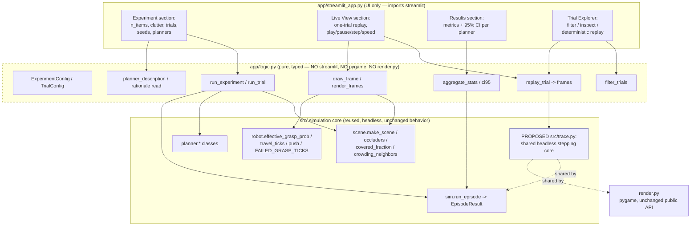
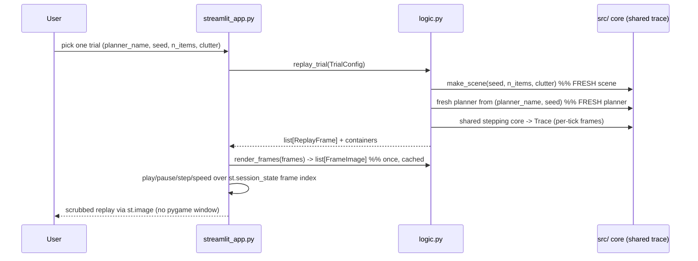

# Design Document: Messy Desk Lab

## Overview

Messy Desk Lab is a Streamlit web app layered over the existing Messy Desk simulation engine and deployed publicly to Streamlit Community Cloud. It presents four sections — **Experiment** (configure objects, clutter, trials, seeds, planners), **Live View** (scrub one trial replay with play/pause/step/speed using pre-rendered headless frames, never a pygame window), **Results** (compare ticks, items sorted, failed grasps, and pushes across planners with 95% confidence intervals), and **Trial Explorer** (filter, inspect, and deterministically replay individual trials).

The app is a thin presentation layer. `app/streamlit_app.py` holds only Streamlit UI calls; all testable logic lives in `app/logic.py`, which imports neither `streamlit`, nor `pygame`, nor `render.py`. The simulation core under `src/` (`scene`, `robot`, `planner`, `sim`, `log`, `compare`, `run_eval`) is reused as-is: the app calls the engine and reads its logs and never duplicates simulation behavior. This Lab is the broader four-section superset of the earlier three-tab `streamlit-demo` spec and stays consistent with the decisions established there (deep-copy scene isolation, replay-matches-sim, headless matplotlib Agg rendering, an app-level `requirements.txt` without pygame, and the logic/UI boundary).

This document is **design only** and **inspection + design only**. It proposes two small, optional, behavior-preserving engine changes (a shared headless trace core, and an optional `planner.last_reason` rationale) for the user's review. It does not implement any UI, does not change simulation behavior, does not tune parameters, and does not fabricate results. Results and README tables are filled only from real `run_episode` / `run_eval` output.

## Files Inspected

The following files were read to ground this design in the engine as it exists today:

- `src/scene.py` — scene model, occlusion and crowding math, constants.
- `src/robot.py` — gripper, primitives, grasp model, timing constants.
- `src/planner.py` — the five planners and their mutable state.
- `src/sim.py` — `run_episode` and `EpisodeResult`.
- `src/log.py` — `EpisodeLogger`, dataset writer, schema constants.
- `src/compare.py` — plain-text comparison table, `_ci95`, `Z_95`.
- `src/run_eval.py` — sweeps, plots, `Stat`/`Metrics`, `_mean`/`_ci95`, `Z_95`.
- `src/render.py` — the only pygame module; `build_trace` / `Trace` / `TickFrame` / `PLANNER_FACTORIES`.
- `requirements.txt` — root dependency list (includes pygame).
- `.gitignore` — confirms `out/` is gitignored.
- `.kiro/specs/streamlit-demo/design.md` and its `.config.kiro` — the sibling spec whose decisions this builds on.

## Architecture



**Module dependency rule (hard constraint):** `UI -> logic -> src/ core`. `app/logic.py` imports neither `streamlit`, nor `pygame`, nor `render`. `app/streamlit_app.py` imports `streamlit` and `app.logic` only — never `src/` math directly for computation and never `render.py`. The simulation core stays headless; only `render.py` may import pygame.

## Sequence Diagrams

### Experiment -> Results flow (batch over seeds x planners)

```mermaid
sequenceDiagram
    participant U as User
    participant APP as streamlit_app.py
    participant L as logic.py
    participant C as src/ core

    U->>APP: set n_items, clutter, trials, seeds, planners; click Run
    APP->>APP: st.spinner, cap batch by time budget
    APP->>L: run_experiment(config)
    loop capped (seeds x planners)
        L->>C: make_scene(seed, n_items, clutter)
        L->>C: run_episode(fresh scene, fresh planner, seed=seed)
    end
    L->>L: aggregate_stats -> mean ± 95% CI per metric per planner
    L-->>APP: ExperimentResult (per-trial rows + aggregates)
    APP->>APP: st.session_state caches result for other sections
    APP-->>U: Results tables/bars with CIs and overlap/tie note
```

### Live View / Trial Explorer replay flow



## A. Engine Interface Surface

The smallest set of symbols the Lab app needs from the engine as it exists today, cited per module. The app calls these; it does not re-implement them.

### `src/scene.py`
- `make_scene(seed: int, n_items: int, clutter: float) -> Scene` — the only scene constructor; fully seeded.
- `occluders(scene: Scene) -> dict[int, list[int]]` — item id -> coverer ids (>25% coverage); used for Trial Explorer occlusion inspection.
- `Scene`, `Item`, `Container` dataclasses — read for drawing and inspection. `Scene.rng` is `compare=False`/`repr=False`, so two scenes from the same seed compare equal by value even though generators differ.
- `covered_fraction(scene, item_id) -> float` — per-item coverage readout for inspection panels.
- `crowding_neighbors(scene, item_id, margin) -> list[int]` — crowding readout for inspection.
- `DESK_W: int = 640`, `DESK_H: int = 480` — drawing bounds.
- `KINDS: tuple[str, ...] = ("pen", "key", "mug", "trash")` — kind set for labels/legends and per-kind encoding.

### `src/robot.py`
- `Gripper`, `Grasp`, `Push` dataclasses — action/state types used by the stepping core and the renderer.
- `effective_grasp_prob(scene, item_id) -> float` — the one grasp-probability model; reused by replay (never reimplemented).
- `travel_ticks(distance: float) -> int` — tick cost of a move; reused by replay.
- `push(scene, item_id, dx, dy) -> None` — push primitive; reused by replay.
- `FAILED_GRASP_TICKS: int = 3` — extra ticks on a failed grasp; reused by replay.
- `TICK_HZ: int = 15` — clock for timestamp conversions in Live View.

### `src/planner.py`
- `RandomPlanner(seed: int = 0)`, `NearestPlanner()`, `LeastCoveredPlanner()`, `NearestRetryPlanner()`, `OcclusionPlanner()` — each exposes `next_action(scene, gripper) -> Grasp | Push | None`. `RandomPlanner` carries its own seeded `numpy.random.Generator`; `NearestRetryPlanner` and `OcclusionPlanner` carry mutable per-run state.

### `src/sim.py`
- `run_episode(scene, planner, logger=None, seed=0, max_ticks=None) -> EpisodeResult` — the authoritative episode runner. The Experiment/Results path calls this directly for metrics.
- `EpisodeResult(items_sorted, items_total, steps, failed_grasps, pushes)` — reused directly for metrics; not duplicated.

### `src/log.py`
- `EpisodeLogger(task)`, `log_frame(...)`, `write_dataset(loggers, out_dir) -> Path` — optional dataset export from the app (writes under `out/` only).
- `FRAME_COLUMNS`, `EPISODE_COLUMNS` — schema constants reused for any dataset preview/validation.

### `src/compare.py`
- `evaluate`, `print_table`, `_ci95`, `Z_95` — statistics reference. The app reuses the same CI definition (`Z_95 = 1.96`, sample std `n-1`, `0.0` for `n < 2`); it does not duplicate or re-derive the math.

### `src/run_eval.py`
- `run_eval`, `evaluate`, `Stat`, `Metrics`, `_mean`, `_ci95`, `Z_95` — statistics + sweep reference. The established "fresh scene + fresh planner per seed" loop in `run_eval.evaluate` is the pattern the app's batch loop mirrors.

### `src/render.py`
- `build_trace(planner_name, seed, n_items, clutter) -> Trace` with per-tick `TickFrame` records (`gx`, `gy`, `items`, `event`, `event_item`, `tick`, `sorted_count`, `failed_count`, `push_count`).
- `PLANNER_FACTORIES: dict[str, callable]` — name -> `(seed) -> planner`.
- `ItemState` / `ContainerState` / `Trace` / `TickFrame` dataclasses.

**Constraint on `render.py`:** it is the ONLY pygame module, and the structure rule forbids any non-render module from importing `render.py`. `render.py` does gate pygame behind local imports inside functions, and `build_trace` itself imports no pygame — but the module-level rule still forbids the app or `app/logic.py` from importing `render.py`. The app therefore cannot reuse `build_trace` by importing it. This motivates the proposed shared trace core in section B(a).

## B. Gap Analysis Per Section — "what is missing"

### B(a) Can `EpisodeResult` scrub a trial step-by-step? — NO

`EpisodeResult` holds only aggregate counts (`items_sorted`, `items_total`, `steps`, `failed_grasps`, `pushes`). It carries no per-step record, so Live View and Trial Explorer cannot scrub, step, or inspect a trial from it. A per-step event/trace record is required.

The per-tick structure already exists: `render.build_trace` produces a `Trace` of `TickFrame`s with exactly the fields the app needs (gripper position, event type, event item, tick, cumulative counters, item snapshots). It would be ideal to reuse, and it is already behavior-faithful — `build_trace` mirrors `run_episode` exactly: same `numpy.random.default_rng(seed)` draw order for grasp outcomes, same `effective_grasp_prob`, same `travel_ticks`, same `FAILED_GRASP_TICKS`, same `push`, same `10 * items_total` default budget.

**The blocker:** `build_trace` lives in `render.py`, the pygame module, and the structure rule forbids the app (or `app/logic.py`) from importing `render.py`. So reuse-by-import is not allowed, even though `build_trace` itself needs no pygame.

**Proposed, behavior-preserving move (for review):** promote the trace data structures and the `build_trace` stepping logic into the headless core — a new `src/trace.py` (preferred, one responsibility per module), or alternatively extend `sim.py`. Then:

- `render.py` imports the trace structures and builder from the core instead of defining them, keeping its public API (`build_trace`, `Trace`, `TickFrame`, `ItemState`, `ContainerState`, `PLANNER_FACTORIES`) unchanged by re-exporting. Existing `render.py` callers and tests are unaffected.
- `app/logic.py` imports the trace builder from `src/trace.py` (never from `render.py`), satisfying the module rule and keeping the app headless.

**Single source of truth so sim and trace cannot drift:** today `run_episode` and `build_trace` are two parallel implementations of the same stepping loop; they can diverge silently. The design proposes one shared stepping core that both call. Two equivalent shapes to evaluate (either is behavior-preserving):

1. `run_episode` optionally emits a trace: add an optional `trace: TraceSink | None = None` parameter; when supplied, `run_episode` appends one `TickFrame` per action (and the opening frame). Metrics-only callers pass nothing and are unaffected. The trace builder becomes a thin wrapper that calls `run_episode` with a sink.
2. A shared private stepping generator (e.g. `_step_episode(scene, planner, seed, max_ticks)` yielding per-action records) that both `run_episode` (folds records into counters) and `build_trace` (collects records into frames) consume.

Both guarantee the trace and `EpisodeResult` come from the same code path, so outcomes for a seed stay identical by construction.

**Flagged as PROPOSED, behavior-preserving, test-gated.** Outcomes for any seed must stay bit-for-bit identical. Required parity test: for a sweep of seeds/planners/configs, the trace's final counters equal the paired `EpisodeResult` fields (`sorted_count == items_sorted`, `failed_count == failed_grasps`, `push_count == pushes`, last `tick == steps`), and existing `src/` tests stay green.

### B(b) Can a trial replay deterministically from ONLY its saved config + seed? — YES

Even though `OcclusionPlanner` and `NearestRetryPlanner` hold mutable state (`self._attempts`, `self._fails`, `self._skip_until`, `self._last_grasp_id`, `self._action_index`) and `RandomPlanner` carries its own seeded rng, a trial is fully reproducible from `(planner_name, seed, n_items, clutter)` because all randomness is seeded and all state is re-derived per run:

- Scene randomness: `make_scene(seed, ...)` via `numpy.random.default_rng(seed)`.
- Planner randomness: `RandomPlanner(seed)` seeds its own generator; the other planners are deterministic given the scene.
- Grasp outcomes: `numpy.random.default_rng(seed)` inside `run_episode` (and inside the shared trace core).

The mutable planner state is re-derived deterministically from a **fresh planner + fixed seed + deterministic scene** every time. The invariant that makes this safe: replay must ALWAYS construct a FRESH planner and a FRESH scene from `(planner_name, seed, n_items, clutter)` and never reuse a planner instance or a mutated scene across runs.

**Saved-config schema needed to replay (and nothing else):**

```python
@dataclass
class TrialConfig:
    """Everything needed to deterministically rebuild and replay one trial."""
    planner_name: str   # key into the planner factory (e.g. "occlusion")
    seed: int           # seeds scene, planner rng, and grasp-outcome rng
    n_items: int        # items on the desk
    clutter: float      # in [0, 1]
```

**Risk to flag:** reusing a planner instance (its counters already advanced) or a mutated scene (items already moved/removed) across runs breaks determinism. The app MUST rebuild both the scene and the planner on every replay. This is an established pattern: `run_eval.evaluate` and `compare.evaluate` already build a fresh scene and a fresh planner per seed for exactly this reason — the design reuses that pattern rather than inventing one.

### B(c) Can a planner report a short rationale for its action? — PROPOSED minimal change

Live View and Trial Explorer benefit from a one-line rationale per action (e.g. "nearest exposed item", "singulating: clearing crowder pays off", "stubborn-retry: pushing coverer", "random push"). Two ways to add it:

- **Option 1 — widen the return.** Change `next_action` to return `(action, rationale)` or an `ActionDecision{action, reason}`. This changes the planner interface signature and touches `sim.run_episode`, the shared trace core, and every caller (`compare`, `run_eval`, `render`, `NoPushPlanner`). High blast radius; risks altering control flow around action handling.

- **Option 2 (RECOMMENDED — least invasive).** Add an OPTIONAL side-effect attribute `planner.last_reason: str` that a planner sets just before returning its chosen action. The trace/app reads `planner.last_reason` AFTER `next_action` returns. `next_action`'s return type and the chosen action are unchanged. Planners that do not set it default to `""`/`None`. This adds zero coupling to `run_episode`'s action handling and cannot change which action is picked.

**Why Option 2:** the rationale is populated opportunistically and read passively; no caller signature changes; `sim.run_episode` is untouched; it is trivially behavior-preserving. Only the shared trace core (which the app controls) reads `getattr(planner, "last_reason", "")` after each `next_action` and stores it on the frame.

**Where each planner sets `last_reason` (mapped to existing branches in `planner.py`):**

| Planner | Branch in `next_action` | `last_reason` |
|---|---|---|
| `RandomPlanner` | push path (`rng.random() < PUSH_PROB`) | `"random push"` |
| `RandomPlanner` | grasp path | `"random grasp"` |
| `NearestPlanner` | the single grasp | `"nearest item"` |
| `LeastCoveredPlanner` | the single grasp | `"least-covered item"` |
| `NearestRetryPlanner` | grasp of nearest non-skipped | `"nearest (non-skipped)"` |
| `NearestRetryPlanner` | fallback when all skipped | `"nearest (all skipped)"` |
| `OcclusionPlanner` | step 1, stubborn-retry `_push_coverer` | `"stubborn-retry: pushing coverer"` |
| `OcclusionPlanner` | step 2, `_declutter_push` | `"singulating: clearing crowder pays off"` |
| `OcclusionPlanner` | step 2, grasp of nearest exposed | `"nearest exposed item"` |
| `OcclusionPlanner` | step 3, all-covered `_push_coverer` | `"all covered: pushing least-covered's coverer"` |

**Flagged as PROPOSED, optional, behavior-preserving.** Required test: enabling rationales (populating `last_reason`) does not change any `EpisodeResult` for any seed/planner/config — compare a run with rationale-reading on against the current engine's result.

## C. Where GUI-Independent Logic Lives

All non-Streamlit logic lives in `app/logic.py` — pure, typed, headless, with NO `streamlit` import, NO `pygame` import, and NO `render.py` import. UI lives in `app/streamlit_app.py` (Streamlit calls, layout, session state, spinners, error surfacing only). The logic module MUST call the existing engine and NEVER duplicate behavior: it reuses `make_scene`, the planner classes, `run_episode`/`EpisodeResult`, the shared trace core, and the CI/stat definitions from `compare`/`run_eval`.

**Dependency rule (restated):** `UI -> logic -> src/ core`. `app/logic.py` imports neither `streamlit`, `pygame`, nor `render`.

Mapping each of the four sections to logic functions and the engine calls they make:

| Section | logic.py functions | Engine calls reused |
|---|---|---|
| **Experiment** | `run_experiment(config) -> ExperimentResult`, `cap_batch_size(...)`, `aggregate_stats(...)` | `make_scene` (fresh per seed), planner classes (fresh per seed), `sim.run_episode` -> `EpisodeResult`; CI via the same `Z_95`/`n-1` definition as `run_eval`/`compare` |
| **Live View** | `replay_trial(TrialConfig) -> list[ReplayFrame]`, `render_frames(frames) -> list[FrameImage]`, `draw_frame(...)` | `make_scene` (fresh), fresh planner, the shared trace core (reused, never reimplemented); `TICK_HZ` for timestamps; matplotlib Agg for drawing |
| **Results** | `aggregate_stats(rows) -> list[PlannerStat]`, `ci95(values)`, `overlap(a, b)` | reuses the `compare`/`run_eval` statistics definition; consumes `EpisodeResult` rows from the Experiment run |
| **Trial Explorer** | `filter_trials(rows, predicate)`, `inspect_trial(TrialConfig) -> TrialDetail`, `replay_trial(TrialConfig)` | `make_scene` (fresh), `occluders`, `covered_fraction`, `crowding_neighbors` for inspection; shared trace core for deterministic replay |

Optional dataset export (if wired) uses `log.EpisodeLogger` + `log.write_dataset(..., out_dir="out")`, writing under `out/` only.

This builds on the sibling `streamlit-demo` spec, which already established deep-copy scene isolation between planners, replay-matches-sim, headless matplotlib Agg rendering, an `app/requirements.txt` without pygame, and the logic/UI boundary. The Lab reuses those decisions; it does not relitigate them.

## D. requirements.txt / Deployment Implications (Streamlit Community Cloud)

### Dependency split

Root `requirements.txt` today is: `numpy`, `pandas`, `matplotlib`, `imageio`, `imageio-ffmpeg`, `pygame`, `pytest`. That set serves the full project (sim, render, dataset, tests).

**Proposed separate app-level file `app/requirements.txt`** WITHOUT `pygame`/`imageio`/`pytest`:

```
numpy
pandas
matplotlib
streamlit
pillow   # only if needed for st.image
```

Streamlit Community Cloud installs from the requirements file it is pointed at. Pointing it at `app/requirements.txt` keeps `pygame` off the headless Cloud container. Pulling `pygame` onto a headless container is a real risk (it drags in SDL/display libraries) and is unnecessary, because Live View uses pre-rendered headless frames and never opens a pygame window. The root `requirements.txt` stays unchanged for local full-project work.

### matplotlib backend risk

The app MUST force the Agg backend before importing `pyplot` (exactly as `run_eval.py` already does: `matplotlib.use("Agg")` before `import matplotlib.pyplot`). Agg needs no display, so rendering works on a headless Cloud container.

### pygame-on-headless risk (reiterated)

Live View MUST use headless frames (matplotlib Agg RGB arrays / pre-rendered), NOT a pygame window. `app/streamlit_app.py` and `app/logic.py` never import `pygame` or `render.py`. The pre-rendered frames are produced via the shared headless trace core plus Agg drawing.

### Long batches under Streamlit's single-threaded rerun model

Streamlit reruns the script top-to-bottom on each interaction and has NO Qt-style background workers. Heavy batch runs (many seeds x planners) must not block a rerun indefinitely. Handling, recommended approach first:

1. **Cap batch size by a time budget** (like the sibling spec's `cap_batch_size`): clamp `trials x planners` so a rerun completes promptly. **Recommended.**
2. **Run synchronously inside `st.spinner`** with the cap applied, so the rerun finishes quickly and the user sees progress. **Recommended.**
3. **Cache across reruns** with `st.session_state` and/or `st.cache_data` so results are not recomputed on every interaction (e.g. scrubbing Live View must not re-run the batch). Chunked/incremental computation can extend a run across reruns if needed.
4. **Optional `st.progress`** across seeds for feedback on larger runs.

**Recommendation:** synchronous-capped execution inside a spinner, with results cached in `st.session_state` / `st.cache_data`. True background threads are discouraged under Streamlit's execution model: there is no first-class worker abstraction, thread results do not integrate cleanly with the rerun lifecycle, and background mutation of session state is fragile. The design does NOT claim background workers exist.

## Components and Interfaces

### Component: `app/streamlit_app.py`

**Purpose:** Streamlit entry point. Renders the four sections, orchestrates `logic.py`, manages `st.session_state`, spinners, progress, and error surfacing. Contains no simulation math.

**Responsibilities:**
- Experiment: controls for `n_items`, `clutter`, trial count, seed set, and planner selection; call `run_experiment` inside `st.spinner` with the batch cap; cache the `ExperimentResult`.
- Live View: pick one trial; call `replay_trial` then `render_frames` once (cached); drive play/pause/step/speed over a `st.session_state` frame index with `st.image`.
- Results: render per-planner mean ± 95% CI tables/bars with an overlap/tie note.
- Trial Explorer: filter/inspect trial rows; deterministically replay a chosen trial by rebuilding scene+planner.

### Component: `app/logic.py`

**Purpose:** All non-Streamlit logic — pure, typed, headless, unit-testable. Imports only `src/`, numpy, matplotlib (Agg), PIL, and stdlib. Never imports `streamlit`, `pygame`, or `render`.

**Interface (typed signatures):**

```python
from dataclasses import dataclass
from src.sim import EpisodeResult

# --- planner metadata ---
def available_planners() -> list[str]:
    """Selectable planner names, order stable for the UI."""

def make_planner(name: str, seed: int) -> object:
    """Construct a FRESH planner by name with a seed, without importing render.py."""

def planner_description(name: str) -> str:
    """One-line plain-English description of a planner."""

# --- scene ---
def build_scene(seed: int, n_items: int, clutter: float):
    """Build one Scene via scene.make_scene (pixels on a 640x480 desk)."""

# --- experiment batch (Experiment + Results) ---
def cap_batch_size(trials: int, n_items: int, n_planners: int) -> int:
    """Clamp trial count so a run finishes within a time budget; min 2."""

def run_experiment(config: "ExperimentConfig") -> "ExperimentResult":
    """Run each planner over each seed on a FRESH scene + FRESH planner per seed.
    Returns per-trial rows plus mean ± 95% CI aggregates. Deterministic in seed."""

def aggregate_stats(rows: list["TrialRow"]) -> list["PlannerStat"]:
    """Mean ± 95% CI per metric per planner, using the run_eval/compare definition."""

# --- replay (Live View + Trial Explorer), via the shared trace core ---
def replay_trial(config: "TrialConfig") -> "ReplayResult":
    """Rebuild FRESH scene + FRESH planner from config and produce per-tick frames
    via the shared headless trace core (no pygame, no render.py). Deterministic."""

def draw_frame(frame, containers, width_px: int = 420, height_px: int = 320):
    """Render one frame to an (H, W, 3) uint8 RGB array with matplotlib Agg."""

def render_frames(frames, containers) -> list["FrameImage"]:
    """Render a whole trace to RGB arrays for st.image scrubbing (once per replay)."""

# --- trial explorer ---
def filter_trials(rows: list["TrialRow"], predicate) -> list["TrialRow"]:
    """Filter trial rows by a pure predicate (planner, seed, metric thresholds)."""

def inspect_trial(config: "TrialConfig") -> "TrialDetail":
    """Rebuild the scene and report occluders / covered_fraction / crowding readouts."""

# --- statistics (reused definition, not re-derived) ---
Z_95 = 1.96
def ci95(values: list[float]) -> float:
    """1.96 * sample_std(n-1) / sqrt(n); 0.0 for n < 2. Same as run_eval/compare."""
def overlap(a: "Stat", b: "Stat") -> bool:
    """True when two 95% intervals overlap (a tie at this sample size)."""
```

### Component: `src/` core (reused)

Used read-only for behavior. The one allowed change set is the PROPOSED, behavior-preserving additions in section B: a shared headless trace core (`src/trace.py` or an extended `sim.py`) and an optional `planner.last_reason`. Both are gated by parity/determinism tests and presented for the user's review, not decided here.

## Data Models

Reuse `EpisodeResult` from `src.sim` directly. Reuse the trace frame shape from the shared core (promoted from `render.TickFrame`). The app layer adds these typed dataclasses in `app/logic.py`:

```python
from dataclasses import dataclass, field
import numpy as np
from src.sim import EpisodeResult


@dataclass
class ExperimentConfig:
    """What the Experiment section configures."""
    n_items: int                 # items per desk
    clutter: float               # in [0, 1]
    seeds: list[int]             # one trial per (seed, planner)
    planners: list[str]          # planner names to compare


@dataclass
class TrialConfig:
    """Minimal, sufficient key to deterministically rebuild and replay one trial."""
    planner_name: str
    seed: int
    n_items: int
    clutter: float


@dataclass
class TrialRow:
    """One trial's config plus its real EpisodeResult metrics."""
    config: TrialConfig
    result: EpisodeResult


@dataclass
class Stat:
    """Mean and 95% interval half-width for one metric over seeds."""
    mean: float
    ci: float


@dataclass
class PlannerStat:
    """Per-planner mean ± 95% CI for each metric over the experiment's seeds."""
    planner: str
    n_trials: int
    ticks: Stat        # steps to clear
    sorted: Stat       # items sorted
    failed: Stat       # failed grasps
    pushes: Stat


@dataclass
class ExperimentResult:
    """All per-trial rows plus the aggregated per-planner stats."""
    rows: list[TrialRow]
    stats: list[PlannerStat]
    config: ExperimentConfig


@dataclass
class ContainerBox:
    """A static drop target for drawing. Center and size in pixels."""
    kind: str
    x: float; y: float; w: float; h: float


@dataclass
class ItemBox:
    """A drawable item snapshot. Center/size in pixels; z is stack height."""
    id: int
    kind: str
    x: float; y: float; w: float; h: float; z: float


@dataclass
class ReplayFrame:
    """One simulated tick of a replay (mirrors the shared-core TickFrame).

    gx/gy is the gripper center in pixels. event is "", "grasp", "fail", "push".
    reason is the optional planner rationale (default ""). Counters are cumulative.
    """
    gx: float; gy: float
    items: list[ItemBox]
    event: str
    event_item: int      # item id acted on, or -1
    reason: str          # optional planner rationale; "" when not set
    tick: int            # simulation tick at 15 Hz
    sorted_count: int
    failed_count: int
    push_count: int


@dataclass
class ReplayResult:
    """A full replay for one trial: frames plus static containers."""
    config: TrialConfig
    frames: list[ReplayFrame]
    containers: list[ContainerBox]
    result: EpisodeResult   # the paired aggregate, for trace-matches-sim checks


@dataclass
class FrameImage:
    """A rendered frame as an RGB array for st.image, with accessible alt text."""
    rgb: np.ndarray         # shape (H, W, 3), dtype uint8
    alt: str


@dataclass
class TrialDetail:
    """Trial Explorer inspection readout for one trial's scene."""
    config: TrialConfig
    occluders: dict[int, list[int]]        # item id -> coverer ids
    covered_fraction: dict[int, float]     # item id -> covered fraction
    crowding: dict[int, list[int]]         # item id -> crowding neighbor ids
```

**Validation rules:**
- `n_items` clamped to the UI range (e.g. 3–30); `build_scene` passes it to `make_scene`, which rejects negatives.
- `clutter` clamped to `[0, 1]` (the UI slider; `make_scene` also clips).
- `FrameImage.rgb` must be shape `(height_px, width_px, 3)`, dtype `uint8`.
- `planner_name` must be in `available_planners()`.
- `TrialConfig` carries exactly `planner_name, seed, n_items, clutter` — the sufficient replay key, nothing more.

## Algorithmic Pseudocode

### Deterministic replay via the shared trace core

Replay reproduces the exact sim outcome for a seed by using the SAME shared stepping core as `run_episode` (section B(a)), so the two cannot drift. It rebuilds a fresh scene and a fresh planner every time.

```python
def replay_trial(config: TrialConfig) -> ReplayResult:
    scene = make_scene(config.seed, config.n_items, config.clutter)  # FRESH
    planner = make_planner(config.planner_name, config.seed)         # FRESH
    # Shared headless trace core: same default_rng(seed) draw order,
    # same effective_grasp_prob, travel_ticks, FAILED_GRASP_TICKS, push.
    trace = build_trace_core(scene, planner, seed=config.seed)
    frames = [to_replay_frame(tf) for tf in trace.frames]
    containers = [ContainerBox(...) for c in trace.containers]
    result = trace.episode_result   # from the SAME code path -> identical to run_episode
    return ReplayResult(config, frames, containers, result)
```

**Preconditions:** `scene` and `planner` are freshly built from `config`; `seed` matches across scene, planner, and grasp draws.
**Postconditions:** final counters equal the paired `EpisodeResult` (`sorted_count == items_sorted`, `failed_count == failed_grasps`, `push_count == pushes`, last `tick == steps`).
**Loop invariant (inside the core):** `sorted_count + len(scene.items) == items_total` after every action.

### Experiment batch (fresh scene + fresh planner per seed)

```python
def run_experiment(config: ExperimentConfig) -> ExperimentResult:
    n = cap_batch_size(len(config.seeds), config.n_items, len(config.planners))
    seeds = config.seeds[:n]
    rows = []
    for name in config.planners:
        for seed in seeds:                       # fresh scene + fresh planner each
            r = run_episode(
                make_scene(seed, config.n_items, config.clutter),
                make_planner(name, seed),
                seed=seed,
            )
            rows.append(TrialRow(TrialConfig(name, seed, config.n_items,
                                             config.clutter), r))
    return ExperimentResult(rows, aggregate_stats(rows), config)
```

### CI aggregation (reuses the run_eval/compare definition)

```python
Z_95 = 1.96

def mean(vals): return sum(vals) / len(vals) if vals else 0.0

def ci95(vals):
    n = len(vals)
    if n < 2: return 0.0
    m = mean(vals); var = sum((v - m) ** 2 for v in vals) / (n - 1)
    return Z_95 * sqrt(var) / sqrt(n)

def overlap(a, b):
    return not (a.mean + a.ci < b.mean - b.ci or b.mean + b.ci < a.mean - a.ci)
```

### Batch cap by time budget

```python
def cap_batch_size(trials, n_items, n_planners) -> int:
    # Episode cost ~ O(n_items) ticks; total work ~ trials * n_planners * n_items.
    # Clamp trials so a rerun stays prompt. Budget is a fixed constant.
    budget = BATCH_WORK_BUDGET
    per_trial = max(n_items * max(n_planners, 1), 1)
    return max(2, min(trials, budget // per_trial))
```

### Headless frame renderer (matplotlib Agg)

```python
def draw_frame(frame, containers, width_px=420, height_px=320) -> ndarray:
    matplotlib.use("Agg")                         # headless; no pygame window
    fig = figure sized width_px x height_px at fixed dpi
    ax.set_xlim(0, DESK_W); ax.set_ylim(DESK_H, 0) # invert y to screen coords
    for c in containers: draw box + KIND letter    # P/K/M/T
    for s in frame.items (low z first):
        color = KIND_COLOR[s.kind]
        if frame.event == "fail" and s.id == frame.event_item: color = FAIL_RED
        draw rect with per-kind outline + letter    # colour never the only cue
    draw gripper circle at (frame.gx, frame.gy); ring color by event
    status: tick, sorted, failed, pushes; optional reason line
    rgb = fig.canvas.buffer_rgba()[:, :, :3].copy()
    assert rgb.shape == (height_px, width_px, 3) and rgb.dtype == uint8
    close fig; return rgb
```

## Correctness Properties

Property 1: Determinism per config. For all `(planner_name, seed, n_items, clutter)`, two calls to `replay_trial` with equal config yield identical trace frames, and the paired `run_episode` yields an identical `EpisodeResult`.

Property 2: Trace matches sim. For all configs, the trace's final counters equal the `EpisodeResult` fields: `sorted_count == items_sorted`, `failed_count == failed_grasps`, `push_count == pushes`, and last `tick == steps`.

Property 3: Fresh rebuild on every replay. `replay_trial` constructs a fresh scene and a fresh planner from the config each call; no planner instance or mutated scene is reused across runs.

Property 4: Rationale is behavior-preserving. Enabling `planner.last_reason` does not change any `EpisodeResult` for any seed/planner/config.

Property 5: CI math matches the engine. `ci95` equals `Z_95 * sample_std(n-1) / sqrt(n)` with `Z_95 == 1.96`, and returns `0.0` for `n < 2`, identical to `run_eval`/`compare`.

Property 6: No forbidden imports. `app/logic.py` imports neither `streamlit`, `pygame`, nor `render` (verifiable via `sys.modules` / source inspection).

Property 7: Output location. Any generated output is written only under `out/`; nothing is written to `data/` or `robotics/`.

## Error Handling

| Scenario | Condition | Response | Recovery |
|---|---|---|---|
| Invalid planner name | name not in `available_planners()` | `make_planner` raises `ValueError` | UI validates against selectbox options, so a user cannot reach it |
| Run failure | exception in `run_experiment`/`replay_trial`/`render_frames` | UI `try/except` -> `st.error("...: <message>")` | user adjusts controls and retries; app stays responsive |
| Batch too large | large trial count or high `n_items` | `cap_batch_size` clamps the trial count | caption: "capped to N trials to stay within the time budget" |
| Empty replay | `n_items == 0` for a trial | zero-frame opening trace; aggregate `items_total == 0` | UI shows "no items on this desk — try another config" |
| Renderer backend | matplotlib must be Agg | `draw_frame` forces `matplotlib.use("Agg")` before pyplot | no display needed on Cloud |

Every Run/Compare/Replay action is wrapped in `with st.spinner(...)` so the user sees progress; the spinner clears when results render.

## Testing Strategy

### Unit tests (`tests/test_logic.py`, no Streamlit import)
- Determinism per config: `replay_trial` twice -> equal frames; paired `run_episode` -> equal `EpisodeResult`.
- Trace matches sim: final trace counters equal the paired `EpisodeResult` (all four fields).
- Fresh rebuild: replaying the same `TrialConfig` twice gives identical results (no cross-run state leakage).
- CI math: `ci95` on a known list equals the hand-computed value; `ci95([x])`/`ci95([])` return `0.0`; `overlap` on known intervals.
- Batch cap: `cap_batch_size` never exceeds the request, never below 2, shrinks as `n_items`/`n_planners` grow.
- Frame renderer: `draw_frame` returns `(height_px, width_px, 3)` `uint8`; a fail event marks only `event_item`.
- No forbidden imports: assert `app.logic` has not imported `streamlit`, `pygame`, or `render`.

### Engine parity tests (for the PROPOSED changes, gating B(a) and B(c))
- Shared trace core: for a sweep of seeds/planners/configs, trace final counters equal `EpisodeResult`, and all existing `src/` tests stay green.
- `planner.last_reason`: enabling rationale reading leaves every `EpisodeResult` unchanged versus the current engine.

### Smoke
- A single `replay_trial` at `n_items=15, clutter=0.9` completes headless well under a second; a capped experiment completes within the time budget.

## Performance Considerations
- Per-tick Agg rendering is the main cost; `render_frames` produces all frames once per replay and the UI indexes into the cached list (scrubbing does not re-render).
- The experiment batch is bounded by `cap_batch_size`; results are cached in `st.session_state` / `st.cache_data` so other sections reuse them without recomputing.
- Rebuilding fresh scenes/planners per trial is cheap relative to episode cost.

## Security Considerations
- No network access at runtime, no uploads, no secrets. Inputs are numeric sliders/selectboxes validated against fixed ranges and the planner name list — no injection surface.
- Reads only repo-local assets; writes nothing to `data/` or `robotics/`. Any generated artifact goes under `out/` (gitignored). `robotics/` stays read-only.

## Dependencies
- `app/requirements.txt` (app + deploy): `numpy`, `pandas`, `matplotlib`, `streamlit`, and `pillow` only if `st.image` needs it. No `pygame`, `imageio`, or `pytest`.
- Root `requirements.txt` unchanged (keeps `pygame`, `imageio`, `imageio-ffmpeg`, `pytest`) for the full project.
- Deployment: Community Cloud main file `app/streamlit_app.py`, requirements `app/requirements.txt`, Python 3.10+. Force the matplotlib Agg backend before importing pyplot.
