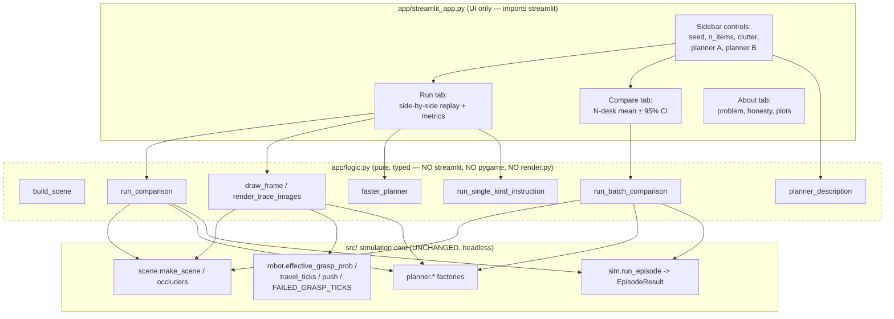
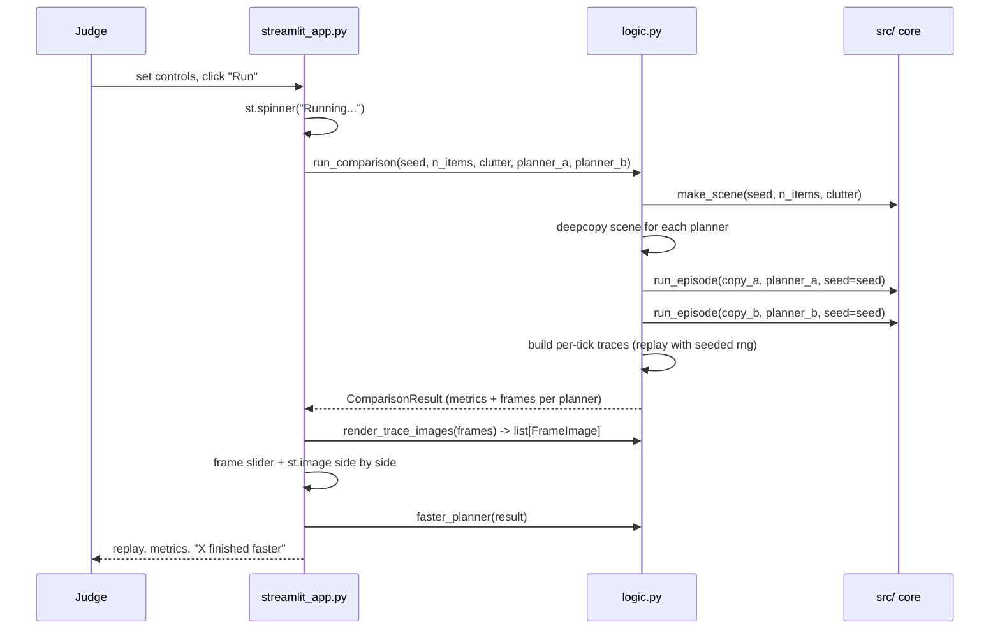
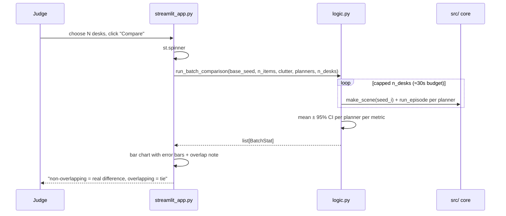

# Design Document: Streamlit Demo

## Overview

A Streamlit web app that lets a hackathon judge try the Messy Desk simulator in under 30 seconds with zero local setup, deployable to Streamlit Community Cloud from the public repo. The judge picks a seed, item count, clutter, and two planners, then watches both planners clear the same desk side by side with scrubbable animated replays, reads per-planner metrics, runs a multi-desk statistical comparison, and reads an honest About page backed by the real evaluation plots.

The app is a thin presentation layer over the existing simulation core. `app/streamlit_app.py` holds only Streamlit UI calls; all testable logic lives in `app/logic.py`, which never imports Streamlit. The simulation core in `src/` (`scene`, `robot`, `planner`, `sim`, `log`) is used **unchanged** — no behaviour, planner, or constant is modified, so results stay identical. The app renders its own frames headless with matplotlib's Agg backend and **never imports pygame or `render.py`**, honouring the structure rule that no module imports from `render.py` (which is the only pygame module).

Determinism is preserved end to end: every scene comes from a seeded `make_scene`, every planner carries its own seeded generator, every replay draws grasp outcomes from a seeded `numpy.random.Generator`, and the two planners in a comparison run on independent `copy.deepcopy` copies of one scene so they never share mutable state (`Scene.rng` is `compare=False`, so deep copies still compare equal by value).

## Architecture



**The explicit boundary:** UI depends on logic; logic depends on `src/`. Logic must not import `streamlit`, `pygame`, or `render.py`. The app re-implements the per-tick replay and drawing that `render.py` does, but headless with matplotlib Agg, reusing the sim's primitives (`effective_grasp_prob`, `travel_ticks`, `push`, `FAILED_GRASP_TICKS`) and a seeded `rng` so the animation reproduces the real sim outcome for a seed.

## Sequence Diagrams

### Run flow (single comparison + replay)



### Compare flow (N-desk statistics)



## Components and Interfaces

### Component: `app/streamlit_app.py`

**Purpose**: Streamlit entry point. Draws the sidebar and three tabs (Run, Compare, About). Contains only Streamlit calls, orchestration of `logic.py` functions, spinners, and error surfacing. No simulation maths.

**Responsibilities**:
- Render sidebar controls (seed, n_items 3–30, clutter 0–1, two planner selectboxes) and show each planner's one-line description via `planner_description`.
- On "Run": call `run_comparison`, render side-by-side replays with a frame slider and `st.image`, render the metrics panel and faster-planner line, all inside `st.spinner` and a `try/except` that surfaces a friendly error.
- On "Compare": call `run_batch_comparison` and draw the mean ± 95% CI chart with the overlap/tie note.
- About tab: static honest copy plus embedded `docs/` plots with alt text.
- Optional instruction box wired to `run_single_kind_instruction`.

### Component: `app/logic.py`

**Purpose**: All non-Streamlit logic — pure, typed, unit-testable, headless. Imports only `src/`, numpy, matplotlib (Agg), PIL, and stdlib. Never imports `streamlit`, `pygame`, or `render.py`.

**Interface** (typed signatures):

```python
from dataclasses import dataclass
import numpy as np
from src.sim import EpisodeResult

# --- planner metadata ---
def available_planners() -> list[str]:
    """Return the selectable planner names (keys), order stable for the UI."""

def planner_description(name: str) -> str:
    """One-line plain-English description of a planner."""

def make_planner(name: str, seed: int) -> object:
    """Construct a planner by name with a seed (mirrors render.PLANNER_FACTORIES
    without importing render.py)."""

# --- scene + single comparison ---
def build_scene(seed: int, n_items: int, clutter: float):
    """Build one Scene via scene.make_scene (pixels on a 640x480 desk)."""

def run_comparison(
    seed: int,
    n_items: int,
    clutter: float,
    planner_a: str,
    planner_b: str,
) -> "ComparisonResult":
    """Run both planners on independent deepcopies of ONE scene; return metrics
    and per-planner per-tick replay frames. Deterministic in seed."""

# --- replay + drawing (headless, matplotlib Agg; RGB arrays) ---
def replay_trace(
    scene, planner, seed: int, max_ticks: int | None = None
) -> list["ReplayFrame"]:
    """Deterministic per-tick replay matching sim.run_episode exactly, reusing
    effective_grasp_prob, travel_ticks, push, FAILED_GRASP_TICKS and a seeded
    rng. Returns drawable per-tick snapshots (no pygame)."""

def draw_frame(
    frame: "ReplayFrame",
    containers: list["ContainerBox"],
    width_px: int = 420,
    height_px: int = 320,
) -> np.ndarray:
    """Render one replay frame to an (H, W, 3) uint8 RGB array with Agg.
    Encodes each kind by BOTH colour and a letter label (P/K/M/T) and a distinct
    outline/shape so colour is never the only cue."""

def render_trace_images(
    frames: list["ReplayFrame"],
    containers: list["ContainerBox"],
) -> list["FrameImage"]:
    """Render a whole trace to a list of RGB arrays for st.image scrubbing."""

# --- metrics + statistics ---
def faster_planner(result: "ComparisonResult") -> str | None:
    """Name of the planner with fewer ticks to clear; None on a tie."""

def run_batch_comparison(
    base_seed: int,
    n_items: int,
    clutter: float,
    planners: list[str],
    n_desks: int,
) -> list["BatchStat"]:
    """Run each planner over n_desks fresh scenes (seeds base_seed..+n_desks-1);
    return mean ± 95% CI per metric per planner. n_desks is capped for a ~30s
    budget by cap_batch_size."""

def cap_batch_size(n_desks: int, n_items: int) -> int:
    """Clamp n_desks so the batch finishes in roughly 30s (see algorithm)."""

# --- optional stretch ---
def run_single_kind_instruction(
    seed: int,
    n_items: int,
    clutter: float,
    planner: str,
    kind: str,
) -> "ComparisonResult":
    """Optional: sort only items of `kind` (e.g. 'put the pen in the cup').
    Filters the scene to that kind before running one planner."""

def instruction_phrases() -> dict[str, str]:
    """Optional: bridge-v2-style phrase per kind, e.g. 'put the pen in the cup'."""
```

**Responsibilities**:
- Build scenes and planners by name without touching `render.py`.
- Run the single comparison on deep-copied scenes and produce traces + metrics.
- Replay deterministically and draw frames headless to RGB arrays.
- Compute mean ± 95% CI batches with a time cap.
- Select the faster planner and format planner copy.

### Component: `src/` core (unchanged)

**Purpose**: The simulation. Used read-only. The app calls `scene.make_scene`, `scene.occluders` (if needed), `robot.effective_grasp_prob`, `robot.travel_ticks`, `robot.push`, `robot.FAILED_GRASP_TICKS`, the planner classes, and `sim.run_episode`. No edits.

## Data Models

Reuse `EpisodeResult` from `src.sim` directly — do not duplicate it. The app layer adds these dataclasses in `app/logic.py`, following the existing dataclass conventions (typed fields, units in comments/docstrings):

```python
from dataclasses import dataclass, field
import numpy as np
from src.sim import EpisodeResult


@dataclass
class ContainerBox:
    """A static drop target for drawing. Center and size in pixels."""
    kind: str
    x: float  # center x, pixels
    y: float  # center y, pixels
    w: float  # width, pixels
    h: float  # height, pixels


@dataclass
class ItemBox:
    """A drawable item snapshot. Center and size in pixels; z is stack height."""
    id: int
    kind: str
    x: float  # pixels
    y: float  # pixels
    w: float  # pixels
    h: float  # pixels
    z: float


@dataclass
class ReplayFrame:
    """Everything needed to draw one simulated tick of one planner's replay.

    gx/gy is the gripper center in pixels at this tick. event is one of
    "", "grasp", "fail", "push". Counters are cumulative up to this tick.
    """
    gx: float  # gripper x, pixels
    gy: float  # gripper y, pixels
    items: list[ItemBox]
    event: str
    event_item: int  # item id the event acts on, or -1
    tick: int  # simulation tick at 15 Hz
    sorted_count: int
    failed_count: int
    push_count: int


@dataclass
class FrameImage:
    """A rendered frame as an RGB array for st.image. alt gives accessible text."""
    rgb: np.ndarray  # shape (H, W, 3), dtype uint8
    alt: str


@dataclass
class ComparisonResult:
    """One scene, two planners run on independent deepcopies.

    frames_a/frames_b are the per-tick replay frames for each planner. result_a/
    result_b are the real EpisodeResults from sim.run_episode.
    """
    planner_a: str
    planner_b: str
    result_a: EpisodeResult
    result_b: EpisodeResult
    frames_a: list[ReplayFrame]
    frames_b: list[ReplayFrame]
    containers: list[ContainerBox]
    seed: int
    n_items: int
    clutter: float


@dataclass
class Stat:
    """Mean and 95% interval half-width for one metric over seeds."""
    mean: float
    ci: float


@dataclass
class BatchStat:
    """Per-planner mean ± 95% CI for each metric over N desks."""
    planner: str
    n_desks: int
    ticks: Stat
    failed: Stat
    pushes: Stat
    sorted: Stat
```

**Validation rules**:
- `n_items` clamped to 3–30 by the UI; `build_scene` passes it straight to `make_scene` (which already rejects negatives).
- `clutter` clamped to [0, 1] (UI slider; `make_scene` also clips).
- `FrameImage.rgb` must be shape `(height_px, width_px, 3)`, dtype `uint8`.
- `planner_a`/`planner_b` must be in `available_planners()`.

## Algorithmic Pseudocode

### Deterministic replay matching `run_episode`

The replay must reproduce the exact sim outcome for a seed. It mirrors `sim.run_episode`'s draw order and tick accounting (travel ticks by distance, a failed grasp adds `FAILED_GRASP_TICKS`), emitting one `ReplayFrame` per action plus an opening frame — the same structure `render.build_trace` uses, but with no pygame.

```python
def replay_trace(scene, planner, seed, max_ticks=None) -> list[ReplayFrame]:
    rng = numpy.random.default_rng(seed)        # same seeding as run_episode
    items_total = len(scene.items)
    max_steps = max_ticks if max_ticks is not None else 10 * items_total

    gripper = Gripper(x=0.0, y=0.0, holding=None)
    steps = sorted_count = failed_count = push_count = 0

    frames = [snapshot(scene, gripper, event="", event_item=-1, tick=0, ...)]

    while scene.items and steps < max_steps:
        action = planner.next_action(scene, gripper)
        if action is None:
            break
        item = scene.item_by_id(action.item_id)
        steps += travel_ticks(distance(gripper, item))   # capped speed per tick
        gripper.x, gripper.y = item.x, item.y

        if isinstance(action, Grasp):
            prob = effective_grasp_prob(scene, action.item_id)
            if rng.random() < prob:                       # SAME draw as the sim
                remove item from scene.items
                sorted_count += 1; event = "grasp"
            else:
                failed_count += 1; steps += FAILED_GRASP_TICKS; event = "fail"
        elif isinstance(action, Push):
            push(scene, action.item_id, action.dx, action.dy)
            push_count += 1; gripper follows item; event = "push"

        frames.append(snapshot(scene, gripper, event, action.item_id, steps,
                               sorted_count, failed_count, push_count))
    return frames
```

**Preconditions:** `scene` is a fresh/deepcopied `Scene`; `planner` is a fresh planner; `seed` matches the one passed to the paired `run_episode` so outcomes agree.
**Postconditions:** the returned frames' final counters equal the paired `EpisodeResult` fields (`sorted_count == result.items_sorted`, `failed_count == result.failed_grasps`, `push_count == result.pushes`, last `tick == result.steps`).
**Loop invariant:** `sorted_count + len(scene.items) == items_total` holds after every iteration.

### Single comparison on deep copies

```python
def run_comparison(seed, n_items, clutter, planner_a, planner_b) -> ComparisonResult:
    base = build_scene(seed, n_items, clutter)
    containers = [ContainerBox(...) for c in base.containers]

    # Independent deepcopies so the two runs never share mutable state.
    scene_a, scene_b = deepcopy(base), deepcopy(base)
    result_a = run_episode(deepcopy(scene_a), make_planner(planner_a, seed), seed=seed)
    result_b = run_episode(deepcopy(scene_b), make_planner(planner_b, seed), seed=seed)

    frames_a = replay_trace(deepcopy(scene_a), make_planner(planner_a, seed), seed)
    frames_b = replay_trace(deepcopy(scene_b), make_planner(planner_b, seed), seed)

    return ComparisonResult(planner_a, planner_b, result_a, result_b,
                            frames_a, frames_b, containers, seed, n_items, clutter)
```

**Note:** `run_episode` mutates its scene and `replay_trace` mutates its scene, so each gets its own deepcopy. Because the same seed and fresh planner are used for both the metric run and the replay of a planner, their outcomes agree (verified by a test). `Scene.rng` is `compare=False`, so deepcopies remain value-equal.

### Headless frame renderer (matplotlib Agg, accessibility-encoded)

```python
def draw_frame(frame, containers, width_px=420, height_px=320) -> ndarray:
    matplotlib.use("Agg")                      # headless; no window, no pygame
    fig = figure sized width_px x height_px at fixed dpi
    ax.set_xlim(0, DESK_W); ax.set_ylim(DESK_H, 0)   # invert y to screen coords

    for c in containers:
        draw rounded rect; text KIND_LETTER[c.kind] centered   # P/K/M/T

    for s in frame.items (low z first):
        color = KIND_COLOR[s.kind]
        if frame.event == "fail" and s.id == frame.event_item: color = FAIL_RED
        draw rect with KIND_SHAPE_OUTLINE[s.kind]   # distinct edge/shape per kind
        draw letter KIND_LETTER[s.kind] (high-contrast) centered  # not colour-only

    draw gripper circle at (frame.gx, frame.gy); ring color by event
    title/status: tick, sorted, failed, pushes (readable font size)

    buf = fig.canvas.buffer_rgba(); rgb = buf[:, :, :3] copied
    assert rgb.shape == (height_px, width_px, 3) and rgb.dtype == uint8
    close fig
    return rgb
```

**Accessibility encoding** — each kind carries three redundant cues so colour is never required:

| kind  | letter | colour (RGB)     | outline / shape cue        |
|-------|--------|------------------|----------------------------|
| pen   | P      | (70,130,220)     | solid thin edge            |
| key   | K      | (220,200,70)     | dashed edge                |
| mug   | M      | (90,190,120)     | thick edge                 |
| trash | T      | (180,90,90)      | double/rounded edge        |

**Preconditions:** `frame` and `containers` are valid; `width_px, height_px > 0`.
**Postconditions:** returns `(height_px, width_px, 3)` `uint8`; a fail event highlights only `event_item`.

### 95% CI batch loop with ~30s cap

Reuse the same statistics as `run_eval.py` (`Z_95 = 1.96`, sample std with `n-1`, `ci = 1.96 * std / sqrt(n)`).

```python
Z_95 = 1.96

def mean(vals):  return sum(vals)/len(vals) if vals else 0.0
def ci95(vals):
    n = len(vals)
    if n < 2: return 0.0
    m = mean(vals); var = sum((v-m)**2 for v in vals)/(n-1)
    return Z_95 * sqrt(var) / sqrt(n)

def cap_batch_size(n_desks, n_items) -> int:
    # Episodes cost ~O(n_items) ticks; keep total work bounded so a run with
    # two planners finishes in ~30s on Community Cloud. Budget is a tuned
    # constant on (n_desks * n_items); clamp n_desks down to fit, min 2.
    budget = BATCH_WORK_BUDGET                 # fixed constant, e.g. 1500
    max_desks = max(2, budget // max(n_items, 1))
    return min(n_desks, max_desks)

def run_batch_comparison(base_seed, n_items, clutter, planners, n_desks):
    n = cap_batch_size(n_desks, n_items)
    stats = []
    for name in planners:
        ticks, failed, pushes, sortd = [], [], [], []
        for i in range(n):                      # fresh scene + fresh planner each seed
            seed = base_seed + i
            r = run_episode(build_scene(seed, n_items, clutter),
                            make_planner(name, seed), seed=seed)
            ticks.append(r.steps); failed.append(r.failed_grasps)
            pushes.append(r.pushes); sortd.append(r.items_sorted)
        stats.append(BatchStat(name, n,
            Stat(mean(ticks), ci95(ticks)), Stat(mean(failed), ci95(failed)),
            Stat(mean(pushes), ci95(pushes)), Stat(mean(sortd), ci95(sortd))))
    return stats
```

**Overlap/tie rule** (shown in the UI note): two planners differ for real on a metric when their 95% intervals do **not** overlap (`a.mean + a.ci < b.mean - b.ci` or vice versa); overlapping intervals are a tie at this sample size.

### Faster-planner selection

```python
def faster_planner(result) -> str | None:
    a, b = result.result_a.steps, result.result_b.steps   # ticks to clear
    if a < b: return result.planner_a
    if b < a: return result.planner_b
    return None                                            # tie
```

### Optional single-kind instruction

```python
def run_single_kind_instruction(seed, n_items, clutter, planner, kind):
    base = build_scene(seed, n_items, clutter)
    base.items = [it for it in base.items if it.kind == kind]  # sort only `kind`
    # run one planner on a deepcopy; reuse replay + metrics path
    ...
```

Phrases (`instruction_phrases`) map each kind to a bridge-v2-style sentence, e.g. `pen -> "put the pen in the cup"`. This is the last, stretch task.

## Correctness Properties

Property 1: Determinism per seed. For all `seed, n_items, clutter, a, b`, two calls to `run_comparison` with equal arguments produce equal metrics and equal frame sequences.

Property 2: Replay matches the sim. For all `seed`, the final counters of `replay_trace(scene, planner, seed)` equal the fields of `run_episode(copy, planner, seed=seed)` (`items_sorted`, `failed_grasps`, `pushes`, `steps`).

Property 3: Planner isolation. Running planner A never mutates the scene seen by planner B (the two runs use independent deepcopies).

Property 4: CI math. `ci95(values)` equals `1.96 * sample_std / sqrt(n)` and returns `0.0` for `n < 2`.

Property 5: Frame shape. `draw_frame(...)` returns an array with `shape == (height_px, width_px, 3)` and dtype `uint8`.

Property 6: Faster-planner selection. `faster_planner` returns the planner with fewer ticks to clear, or `None` when the two are equal.

Property 7: Single-kind filter. After `run_single_kind_instruction`, every item acted on is of the requested `kind`.

Property 8: No forbidden imports. `app/logic.py` imports neither `streamlit`, `pygame`, nor `render`.

## Error Handling

| Scenario | Condition | Response | Recovery |
|---|---|---|---|
| Invalid planner name | name not in `available_planners()` | `logic.make_planner` raises `ValueError` | UI validates against the selectbox options, so this should not reach a judge |
| Run failure | any exception inside `run_comparison` / `render_trace_images` | UI wraps the call in `try/except`, shows `st.error("Something went wrong running the simulation: <message>")` | Judge can adjust controls and retry; app stays responsive |
| Batch too large | `n_desks` large or `n_items` high | `cap_batch_size` clamps `n_desks` down | UI shows a caption: "capped to N desks to keep this under ~30s" |
| Empty single-kind scene | no items of the chosen kind for that seed | result has `items_total == 0` | UI shows "no `<kind>` items on this desk — try another seed" |
| Renderer backend | matplotlib must be Agg | `draw_frame` sets `matplotlib.use("Agg")` before importing pyplot | no display needed; works on Community Cloud |

**Loading state:** every "Run" and "Compare" action is wrapped in `with st.spinner("Running simulation..."):` so the judge sees progress; the spinner clears when results render.

## Testing Strategy

### Unit testing approach (`tests/test_logic.py`, no Streamlit import)

- **Determinism per seed:** `run_comparison` with identical args twice → equal metrics and equal frame counts/positions.
- **Metrics match a direct `run_episode`:** for a seed, `run_comparison`'s `result_a`/`result_b` equal a direct `run_episode` on a deepcopy with the same planner and seed (all five fields).
- **Replay matches sim:** final `replay_trace` counters equal the paired `EpisodeResult`.
- **CI math:** `ci95` on a known list equals the hand-computed `1.96 * std / sqrt(n)`; `ci95([x])` and `ci95([])` return `0.0`.
- **`cap_batch_size`:** never exceeds the requested `n_desks`, never below 2, shrinks as `n_items` grows.
- **Faster-planner:** lower `steps` wins; equal `steps` → `None`.
- **Frame renderer:** `draw_frame` returns `(height_px, width_px, 3)` `uint8`; a fail event marks only `event_item`.
- **Accessibility encoding:** every kind maps to a distinct letter and a distinct outline/shape cue (not only colour).
- **Single-kind filter (optional):** after `run_single_kind_instruction`, all acted-on items are the requested kind; wrong/empty kind handled.
- **No forbidden imports:** assert `app.logic` module has not imported `streamlit`, `pygame`, or `render` (inspect `sys.modules` / source).

Run `pytest -q` after each task. The simulation core tests must remain green — the app adds files only and changes nothing under `src/`.

### Integration / smoke

- A single `run_comparison` at `n_items=15, clutter=0.9` completes headless well under a second; a capped batch completes within the ~30s budget.

## Performance Considerations

- Per-tick frame rendering with matplotlib Agg is the main cost. Render lazily/cached so scrubbing the slider does not re-render every frame each interaction; `render_trace_images` produces all frames once per run and the UI indexes into the list.
- The batch comparison is bounded by `cap_batch_size`; default `n_desks = 30` matches `run_eval.py`, adjustable but capped.
- Deep copies are cheap relative to episode cost (tens of small dataclasses).

## Security Considerations

- No network access at runtime, no user file uploads, no secrets. Inputs are numeric sliders/selectboxes validated against fixed ranges and the planner name list, so there is no injection surface.
- The app reads only repo-local, read-only assets (`docs/` plots); it writes nothing to `data/` or `robotics/`. Any generated artifact (none required by the app) would go under `out/`.

## Dependencies

The app must run **without pygame**. Express app dependencies in an app-level file for Streamlit Community Cloud so the deploy does not pull the root `requirements.txt` (which includes `pygame`).

- **`app/requirements.txt`** (app + deploy): `numpy`, `pandas`, `matplotlib`, `streamlit`, `pillow`.
- Root `requirements.txt` stays as-is for the full project (keeps `pygame`, `imageio`, `pytest` for the sim/render/tests).

**Deployment (Streamlit Community Cloud):**
- Entry point / main file: `app/streamlit_app.py`.
- Point the Community Cloud app at `app/requirements.txt` (no pygame), Python 3.10+.
- README gains a short **Run locally** (`pip install -r app/requirements.txt` then `streamlit run app/streamlit_app.py`) and **Deploy** (connect the public repo, set main file `app/streamlit_app.py`, requirements `app/requirements.txt`) section.

## About tab content (honesty rule)

Static copy plus embedded `docs/` plots, each with alt text:
- **The problem:** sort overlapping desk items (pens, keys, mugs, trash) into containers; clutter causes occlusion.
- **How the simulation works:** 640×480 desk, 15 Hz ticks, kinematic gripper, grasp success `1 − 0.8·covered_fraction` with a crowding penalty; this is a **simulation** — perception is **not** real vision, there are no images or real trajectories.
- **Honest findings (from `out/results.md`):** occlusion-awareness beats coverage-blind planners (nearest degrades badly at high item counts and clutter 0.9); a simple least-covered rule (`leastcov`) matches the occlusion planner; pushing did not help (ablation `pushes_on` vs `pushes_off` nearly identical).
- **Plots:** embed `docs/ticks_vs_items.png` (alt: "ticks to clear vs item count per planner"), `docs/failed_vs_items.png` (alt: "failed grasps vs item count per planner"), `docs/sensitivity.png` (alt: "planner ranking across grasp/clearance constants"), `docs/ablation.png` (alt: "occlusion planner with pushes on vs off"), and `docs/demo.gif` (alt: "side-by-side planner demo animation").
