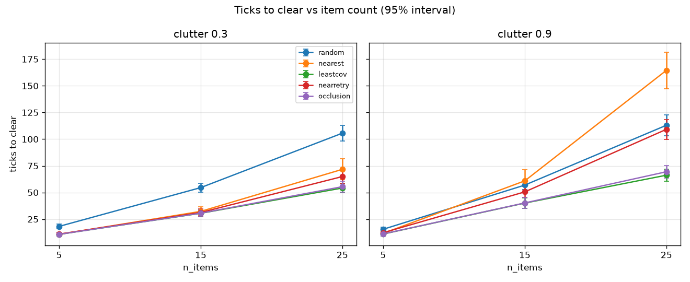
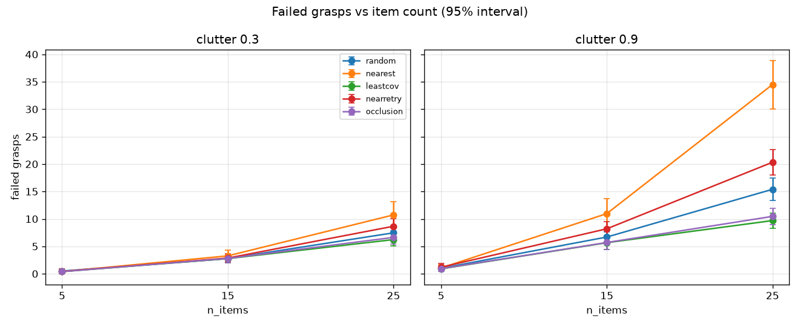
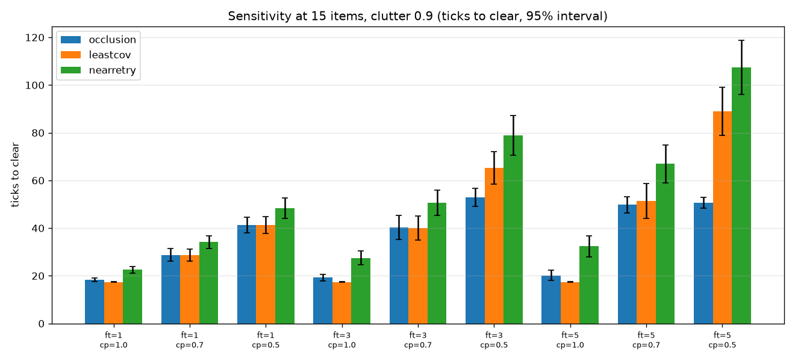
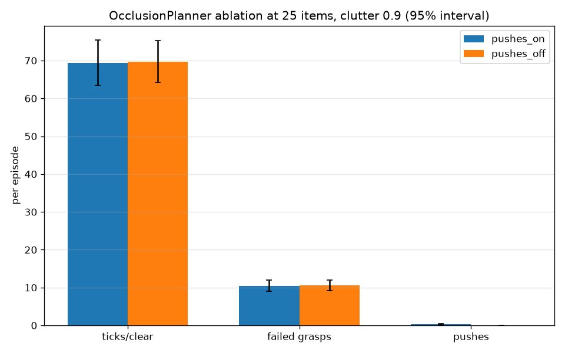
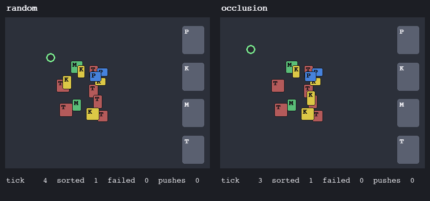

# Messy Desk: Occlusion-Aware Object Sorting

A 2D simulation framework for sorting cluttered, overlapping desk items into the
right containers. It lets you build and compare sorting policies — rule-based
heuristics now, with reinforcement learning possible later — against each other
on the same randomized scenes.

## Problem

Robots sort uniform objects in fixed grids well, but struggle with overlapping
everyday items like pens, keys, mugs, and trash, where one object hides another.
This is the Hackachusetts "Messy Desk: Dynamic Object Sorting" robotics
challenge.

## Approach

- **Randomized desk generator** — a 640x480 px desk with a clutter level (how
  tightly items are packed) and a stacking order (higher items sit on top).
- **Occlusion rule** — an item is "covered" when a higher item overlaps more
  than 25% of its area. Grasp success falls as coverage rises.
- **Kinematic gripper at 15 Hz** — moves at a capped speed and has two actions:
  `grasp` (lift an item into its container) and `push` (shove an item aside to
  singulate a cluttered pile).
- **Five planners**, all rule-based — nothing is trained:
  - `random` — pick a random item, sometimes push.
  - `nearest` — grasp the closest item, ignoring coverage.
  - `nearretry` — nearest, but skip an item that keeps failing.
  - `leastcov` — grasp the least-covered (easiest) item.
  - `occlusion` — grasp exposed items first and push to uncover or singulate
    when the expected payoff beats the cost.

These are hand-written heuristics. No learning, no neural networks.

## Dataset format

Every run can be logged in the same shape as BridgeData V2 and DROID, so the
simulation doubles as a reusable robotics dataset (see `src/log.py`):

- `out/dataset/meta/episodes.csv` — one row per episode: `episode`, `task`
  (the natural-language instruction), `frames` (step count).
- `out/dataset/data/episode_{index:06d}.csv` — one row per action with columns:
  `frame_index`, `timestamp` (seconds since start, tick / 15 Hz),
  `state_x`/`state_y` (gripper position, px), `holding` (held item id or -1),
  `action_type` (`grasp` or `push`), `action_x`/`action_y` (item center for a
  grasp, push delta for a push, px), `reward` (1.0 on a successful grasp, else
  0.0), and `done` (True on the final frame).

## Results

Measured over 30 desks per setting, reported as mean ± 95% interval. Two results
count as different only when their intervals do not overlap. Numbers below are
copied from `out/results.md`, which is regenerated by `python src/run_eval.py`.

**(a) At high clutter, occlusion-aware planning is far faster with fewer failed
grasps than coverage-blind planners** (clutter 0.9, 25 items):

| planner | ticks to clear | failed grasps |
|---|---|---|
| nearest (coverage-blind) | 164.5 ± 17.1 | 34.50 ± 4.41 |
| occlusion | 69.4 ± 6.0 | 10.47 ± 1.50 |
| leastcov | 66.2 ± 5.6 | 9.70 ± 1.39 |

**(b) A simple least-covered greedy rule matches the occlusion planner at the
default settings.** At `FAILED_GRASP_TICKS=3`, `CLEARANCE_PENALTY=0.7` the two
are a tie (occlusion 40.2 ± 5.0 vs leastcov 40.1 ± 5.0, intervals overlap). In
the 9-setting sensitivity sweep (15 items, clutter 0.9), occlusion clearly wins
only when crowding is heavily penalized (2 settings), LeastCovered clearly wins
in 2 settings, and the remaining 5 are ties.

**(c) Pushes did not help.** In the push ablation (25 items, clutter 0.9),
disabling pushes changed nothing within the intervals:

| arm | ticks to clear | failed grasps | pushes |
|---|---|---|---|
| pushes on | 69.4 ± 6.0 | 10.47 ± 1.50 | 0.33 ± 0.22 |
| pushes off | 69.7 ± 5.5 | 10.60 ± 1.38 | 0.00 |

Plots and the demo are generated into `out/` (which is gitignored). Run the
commands below to create them.







## Limitations

- It is a 2D simulation with a hand-written grasp model — no real computer
  vision and no hardware.
- The starter kit supplied only instruction phrasing and episode scale, not
  images or trajectories.
- The penalty constants (`CLEARANCE_PENALTY`, `FAILED_GRASP_TICKS`) were chosen
  before the comparison and were not tuned afterward to favor any planner.

## Run it

```bash
python -m venv .venv
source .venv/bin/activate
pip install -r requirements.txt

pytest -q                     # run the test suite
python src/compare.py         # text table comparing the five planners
python src/run_eval.py        # sweeps -> out/plots/*.png and out/results.md
python src/render.py --headless --seed 3 --out out/demo.mp4  # demo video
```

`render.py` writes an mp4 when an ffmpeg backend is available (installed via
`imageio-ffmpeg`), otherwise it falls back to a `.gif` with the same name.

## Project structure

```
messy_desk/
  src/
    scene.py       # desk, items, occlusion and crowding geometry
    robot.py       # gripper, grasp model, push primitive
    planner.py     # the five planners
    sim.py         # run_episode: drives a planner against a scene
    log.py         # EpisodeLogger + dataset writer (bridge-v2 / droid shape)
    compare.py     # text benchmark table
    run_eval.py    # sweeps, plots, and out/results.md
    render.py      # pygame demo video (the only module that imports pygame)
  tests/           # one test file per module
  robotics/        # read-only starter-kit data (instruction phrasing, scale)
  out/             # generated plots, datasets, videos (gitignored)
  requirements.txt
  README.md
```
